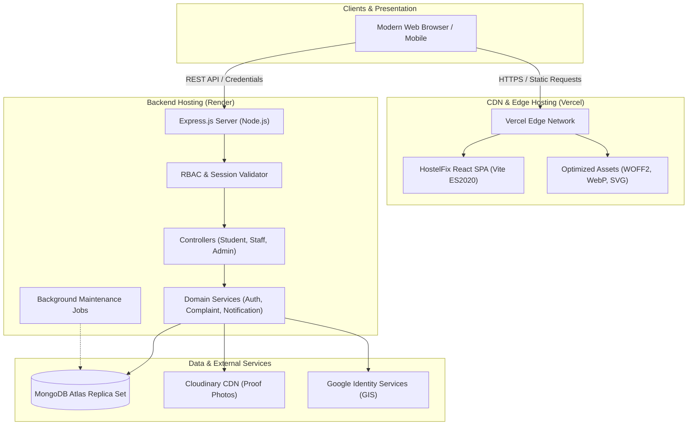
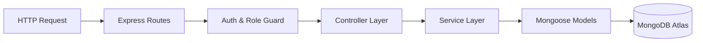
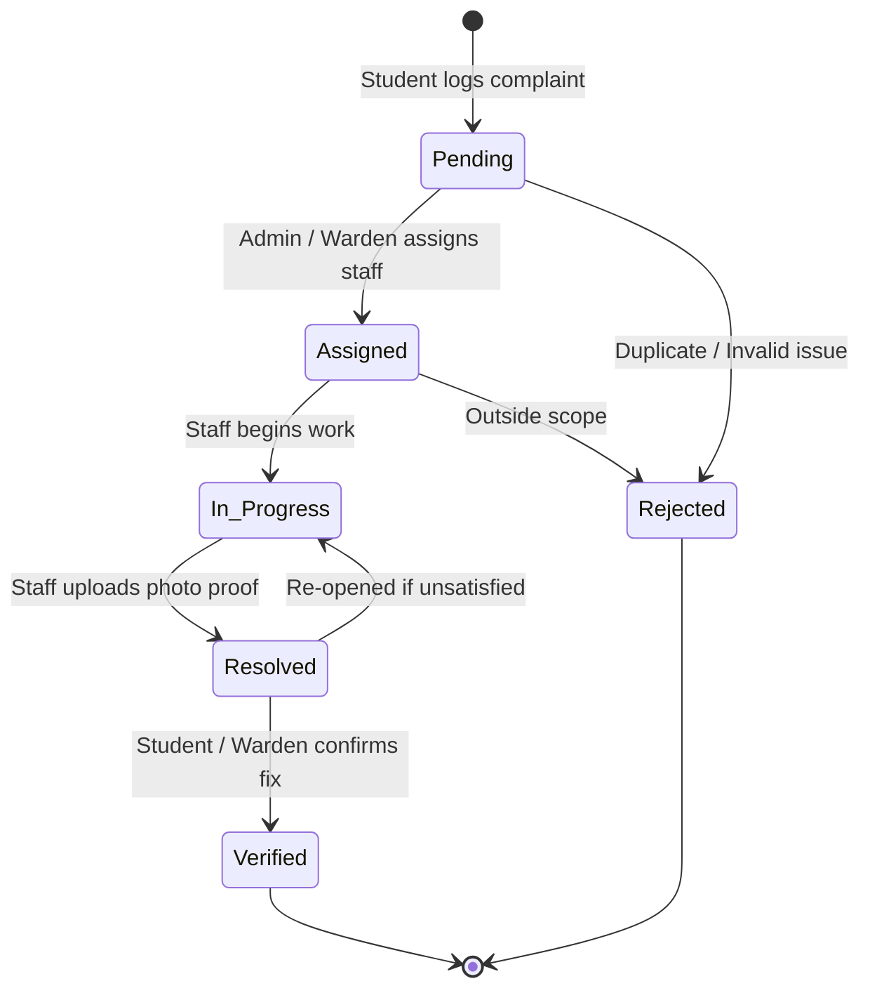

# HostelFix System Architecture

Comprehensive architectural blueprint of the HostelFix smart hostel complaint and maintenance platform.

## High-Level System Architecture



---

## 1. Frontend Architecture

### Core Technologies
- **Framework**: React 19 + Vite 8
- **Routing**: React Router 7 (Route-level code splitting via `React.lazy()` & `<Suspense>`)
- **Styling**: Tailwind CSS + Custom CSS Variables + Self-Hosted Variable WOFF2 Fonts (`Outfit`, `Plus Jakarta Sans`)
- **Animation & 3D**: Framer Motion
- **Visuals & Charts**: Chart.js + react-chartjs-2 (isolated chunks loaded on demand)
- **Icons**: Lucide React (tree-shaken vendor chunk)

### Directory Structure
```
frontend/
├── public/                  # Static assets served at root
│   ├── robots.txt           # Production search crawler rules
│   ├── sitemap.xml          # Canonical public sitemap
│   ├── favicon.png          # High-resolution favicon
│   ├── logo-icon.png        # Native icon raster
│   ├── logo-icon.webp       # WebP optimized logo
│   └── fonts/               # Self-hosted variable WOFF2 fonts
│
├── src/
│   ├── assets/              # Bundled image, icon, and font registries
│   │   ├── images/          # Hero, logos, marketing artwork
│   │   ├── icons/           # App icons, SVG vectors
│   │   └── fonts/           # Font manifests and fallbacks
│   │
│   ├── components/
│   │   ├── common/          # Page loaders, top progress bars, spinners
│   │   ├── layout/          # ProtectedRoute, Layout wrappers
│   │   ├── navigation/      # Navigation bars and loaders
│   │   ├── ui/              # Atom badges, avatars, category selectors
│   │   └── shared/          # 3D interactive carousel, modal dialogs
│   │
│   ├── pages/
│   │   ├── landing/         # Marketing landing page & hero
│   │   ├── auth/            # Student, Staff, Admin login pages
│   │   ├── student/         # Student dashboard, complaints, profile
│   │   ├── staff/           # Staff dashboard, task queue, history
│   │   ├── warden/          # Warden administration views
│   │   └── admin/           # Super-admin management and analytics
│   │
│   ├── layouts/             # Shared layout shells (Admin, Staff, Student)
│   ├── routes/              # Central route tree and lazy route transitions
│   ├── hooks/               # Custom React hooks (useAuth)
│   ├── context/             # Global React Context providers (AuthContext)
│   ├── services/            # API client, auth service, upload service
│   ├── utils/               # Formatters, helpers, string utilities
│   ├── constants/           # Roles, statuses, priorities, block enumerations
│   ├── config/              # Runtime environment and endpoint config
│   ├── styles/              # Global CSS stylesheets and Tailwind imports
│   ├── App.jsx              # Top-level application bootstrap
│   └── main.jsx             # React DOM root entrypoint
```

---

## 2. Backend Architecture

### Core Technologies
- **Framework**: Node.js + Express 4
- **Database**: MongoDB Atlas via Mongoose 8
- **Authentication**: Dual Auth (Google OAuth 2.0 via `google-auth-library` + Password hashing via `bcryptjs`)
- **Session Security**: Cryptographically signed `httpOnly`, `sameSite`, `secure` session cookies + Bearer token fallback
- **File Uploads**: Multer stream pipeline with direct Cloudinary storage

### Controller-Service-Repository Pattern


- **Routes (`src/routes/`)**: Map HTTP verbs and endpoints to middlewares and controllers.
- **Middleware (`src/middleware/`)**: Authenticate sessions, enforce role boundaries, sanitize inputs, and handle errors.
- **Controllers (`src/controllers/`)**: Validate request structures, invoke domain services, and return standard JSON envelopes.
- **Services (`src/services/`)**: Business logic (e.g., SLA calculation, status transitions, notifications).
- **Models (`src/models/`)**: Strongly typed Mongoose schemas with compound indexes.
- **Jobs (`src/jobs/`)**: Maintenance routines for SLA breach auditing and expired session cleanups.

---

## 3. Complaint Lifecycle & State Machine



---

## 4. Security Architecture

1. **Defense in Depth**:
   - Helmet HTTP headers (`Content-Security-Policy`, `X-Content-Type-Options`, `Strict-Transport-Security`).
   - Rate limiting via `express-rate-limit` on authentication endpoints.
   - Cross-student data isolation: Students can only view, edit, or submit feedback on complaints originating from their own ID.
   - Admin routes strictly protected by RBAC; privilege escalation payloads are rejected.

2. **Database Resilience**:
   - Connection pooling: Minimum 2 warm sockets, maximum 10 concurrent connections.
   - Fast-fail timeout: `serverSelectionTimeoutMS: 5000` prevents thread-pool exhaustion.
   - Windows DNS resolver fallback: Google DNS (`8.8.8.8`, `1.1.1.1`) applied conditionally on Windows to circumvent SRV record lookup issues.

